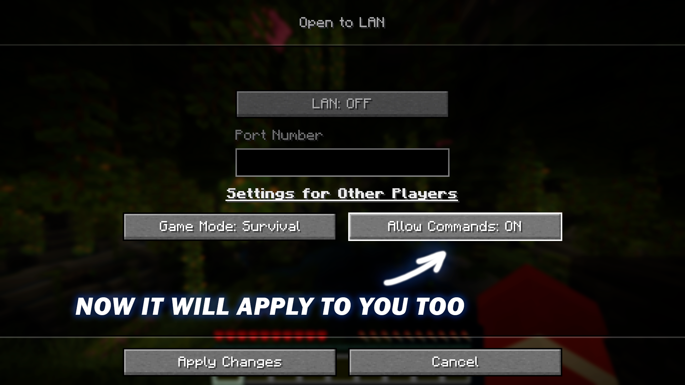

# LAN Host Commands

Or, in other words, "Letting you use commands too".

## Why it's Needed

TLDR: Enabling commands for yourself in **worlds where commands are disabled**.

In **26.2+** Minecraft changed LAN functionality in a way that now you can **only let other players** get command permissions, **but you don't**. This may be inconvinient for many who are already used to quickly enabling commands in a few clicks.

Of course this is not required if your world has already been created with "Commands Allowed". You would already always have command access.

## Functionality

This mod makes it so in worlds with disabled commands **YOU** (the host) have **the same command permissions** as "Other Players" in the "Open to LAN" menu. That's it.

Basically, you can now quickly get command permissions in singleplayer for one session just as before.

Without this only other playes could use commands, but now you too.  